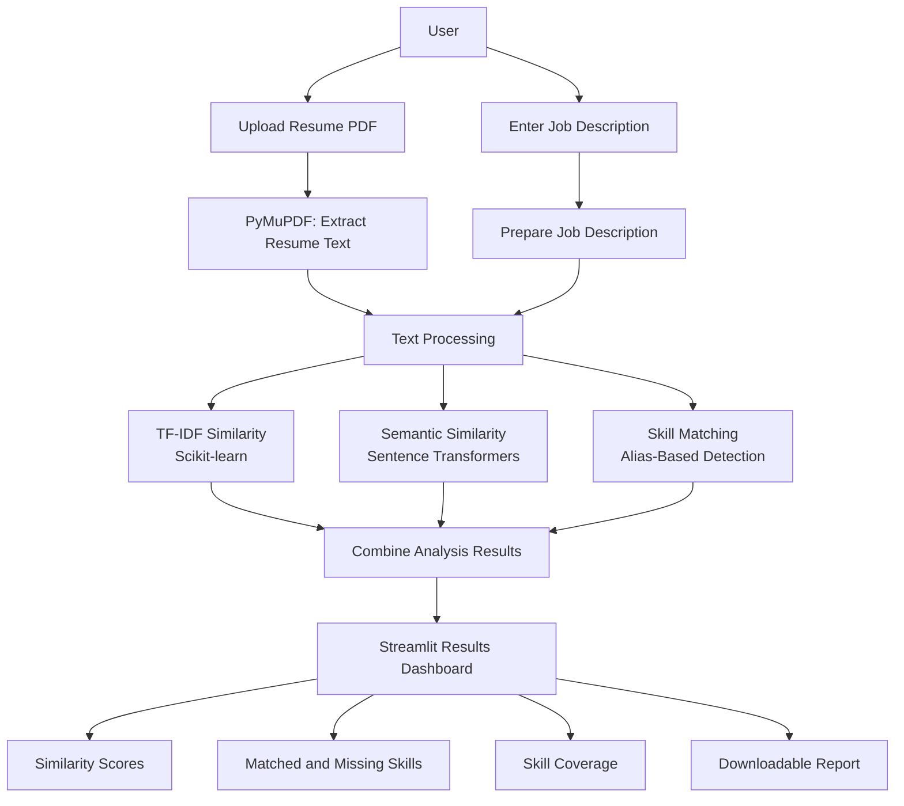

# NexaMatch — System Architecture

## Architecture Diagram

## Architecture Description

NexaMatch follows a sequential processing architecture. The user provides a resume in PDF format and a job description. PyMuPDF extracts the resume text, and the application prepares the text for comparison.

The matching engine uses TF-IDF-based similarity and semantic similarity to compare the resume with the job description. A separate skill-matching component detects recognized skills and identifies matching and missing skills.

Finally, Streamlit displays the analysis results, including similarity scores and skill coverage, and provides an option to download the report.

## Main Components

1. **Input Layer:** Accepts the resume PDF and job description.
2. **Text Extraction Layer:** Extracts text from the resume using PyMuPDF.
3. **Matching Layer:** Calculates TF-IDF and semantic similarity scores.
4. **Skill Analysis Layer:** Identifies recognized matching and missing skills.
5. **Presentation Layer:** Displays results through the Streamlit dashboard.
6. **Report Generation:** Creates a downloadable analysis report.
